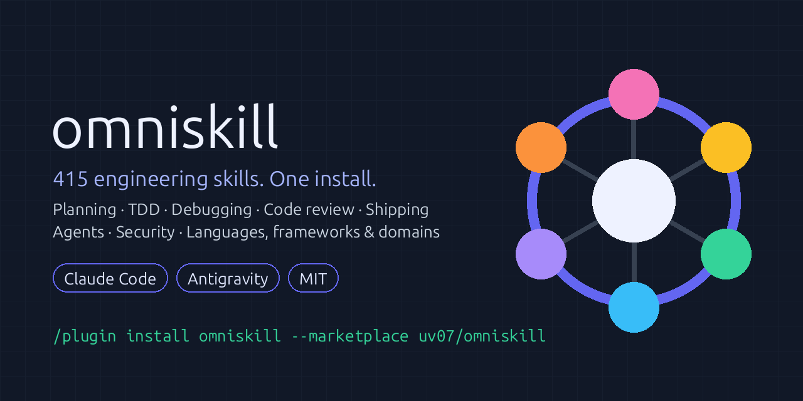
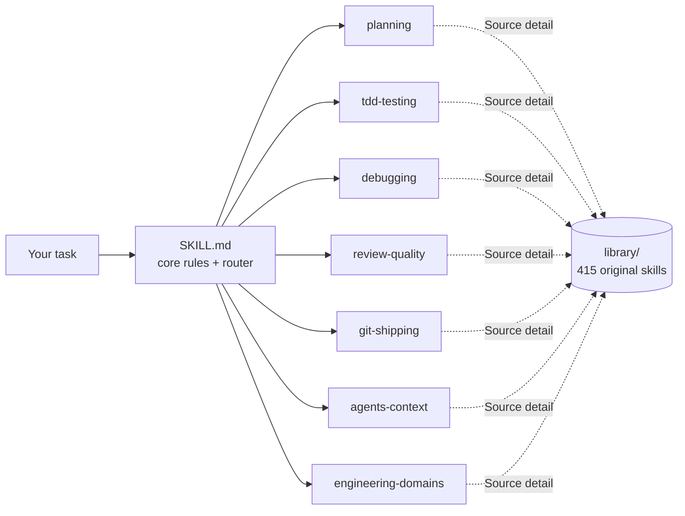

<div align="center">



# omniskill: the all-in-one agent skill for Claude Code and Antigravity

**415 battle-tested engineering skills from six top open-source collections, merged into one skill that loads only what each task needs.**

[](https://github.com/uv07/omniskill/actions/workflows/validate.yml)
[](LICENSE)
[](library/INDEX.md)
[](#1-claude-code-plugin-recommended-for-claude-code)
[](#2-one-line-installer-claude-code-andor-antigravity)
[](https://github.com/uv07/omniskill/stargazers)

[Install](#install) · [Why omniskill](#why-omniskill) · [How it works](#how-it-works) · [What's inside](#whats-inside) · [FAQ](#faq) · [Contributing](CONTRIBUTING.md)

</div>

---

## Why omniskill

Installing several skill packs side by side gives your AI coding agent hundreds of overlapping, sometimes conflicting instructions, and every skill description eats context in every session. omniskill fixes that:

- 🧭 **One router, not 415 triggers.** A single `SKILL.md` adds about 370 tokens to each session. Playbooks and library skills load only when a task needs them.
- 🧠 **Conflicts already resolved.** Eight merged playbooks combine the strongest rules from every source and note which source won where they disagreed.
- 📚 **Nothing lost.** Every original skill is kept word for word in `library/`, with a searchable index, so the agent can open the full depth when it needs it.
- ✅ **Disciplined by default.** Think before coding, test first, find the root cause before fixing, and show evidence before saying "done".
- 🔌 **Works where you work.** Claude Code plugin, Google Antigravity, per-project installs for teams, and plain Markdown for any other agent.
- 🔍 **Checked on every change.** CI validates the structure and all 840 internal links.

## How it works



1. **`SKILL.md`** is always loaded: the core rules and a task router.
2. **`playbooks/`** hold eight merged playbooks (about 5,500 lines), and only the one that fits the task is read.
3. **`library/`** keeps every original skill word for word as `SKILL_SOURCE.md`, plus `library/INDEX.md`. The files are renamed so hosts don't register 415 separate skills.

A feature runs **planning → tdd-testing → review-quality → git-shipping**. A bug runs **debugging → regression test → review → ship**.

## What's inside

| Source | Skills | Known for |
|---|---:|---|
| [obra/superpowers](https://github.com/obra/superpowers) | 15 | Brainstorming, plans, TDD, systematic debugging, worktrees, subagent-driven development |
| [mattpocock/skills](https://github.com/mattpocock/skills) | 39 | Grilling requirements, specs and tickets, codebase design, triage, handoffs |
| [affaan-m/ecc](https://github.com/affaan-m/ecc) | 328 | Languages, frameworks, DevOps, security, data, mobile, LLM apps and business domains |
| [multica-ai/andrej-karpathy-skills](https://github.com/multica-ai/andrej-karpathy-skills) | 1 | Karpathy's coding guidelines: simplicity, surgical changes, goal-driven work |
| [DietrichGebert/ponytail](https://github.com/DietrichGebert/ponytail) | 6 | Smallest-change "lazy senior dev" mode, audits and a shortcut/debt ledger |
| [addyosmani/agent-skills](https://github.com/addyosmani/agent-skills) | 26 | Spec-driven development, accessibility, performance, shipping and launch |

| Playbook | Covers |
|---|---|
| `core-principles.md` | Karpathy guidelines, evidence before claims, root cause before fix, test first |
| `planning.md` | Ideas, interviews, specs and PRDs, plans, tickets, execution |
| `tdd-testing.md` | Red-green-refactor, verification gate, E2E and browser tests, LLM evals |
| `debugging.md` | Gated root-cause process, bisection, flaky tests, incidents |
| `review-quality.md` | Giving and receiving code review, simplification, tech debt |
| `git-shipping.md` | Worktrees, commits, PRs, CI/CD, launch, ADRs, migrations, handoffs |
| `agents-context.md` | Subagents, parallel agents, context budgets, writing skills and prompts |
| `engineering-domains.md` | API design, architecture, security, performance, UI, accessibility, observability, plus a routing catalog for every library skill |

## Install

Anyone can install it. You need `git`; nothing else. Pick **one** method.

### 1. Claude Code plugin (recommended for Claude Code)

Inside Claude Code:
```
/plugin install omniskill --marketplace uv07/omniskill
```
On older Claude Code versions, use two steps:
```
/plugin marketplace add uv07/omniskill
/plugin install omniskill@omniskill
```
Update later with `/plugin marketplace update omniskill`.

### 2. One-line installer (Claude Code and/or Antigravity)

macOS / Linux / WSL. Installs for every host it finds (`~/.claude`, `~/.gemini`):
```bash
curl -fsSL https://raw.githubusercontent.com/uv07/omniskill/main/install.sh | bash
```
Windows PowerShell:
```powershell
irm https://raw.githubusercontent.com/uv07/omniskill/main/install.ps1 | iex
```

Choose a target yourself:
```bash
git clone https://github.com/uv07/omniskill && cd omniskill
./install.sh --claude                 # ~/.claude/skills/omniskill
./install.sh --antigravity            # ~/.gemini/config/skills/omniskill
./install.sh --project ~/code/myapp   # myapp/.claude/skills and myapp/.agents/skills (commit it so your team gets it)
./install.sh --update                 # git pull every install
./install.sh --uninstall              # remove (only touches omniskill installs)
```
PowerShell takes the same options as `-Claude`, `-Antigravity`, `-Project DIR`, `-Update` and `-Uninstall`.

### 3. Manual clone

```bash
git clone https://github.com/uv07/omniskill ~/.claude/skills/omniskill          # Claude Code
git clone https://github.com/uv07/omniskill ~/.gemini/config/skills/omniskill   # Antigravity
# older Antigravity versions: ~/.gemini/antigravity/skills/omniskill
```

### Other agents

The skill is plain Markdown with standard `SKILL.md` frontmatter. Any agent that loads skill folders can use it from its skills directory. Agents without skill support can still use it: add a line such as "Before any coding task, read `<path>/omniskill/SKILL.md` and follow its router" to `AGENTS.md`, `GEMINI.md` or your rules file.

### Check it works

Restart the app, then ask: *"Which omniskill playbook applies to a flaky test?"* It should answer with `playbooks/debugging.md`. You can also call it directly with `/omniskill` (Claude Code) or "Use the omniskill skill to ...".

## Usage examples

| You say | omniskill loads |
|---|---|
| "Let's build a CSV import feature" | `playbooks/planning.md`, then `tdd-testing.md` per task |
| "This test fails intermittently" | `playbooks/debugging.md` (flaky-test section) |
| "Review my PR" | `playbooks/review-quality.md` |
| "Harden this Django view" | `playbooks/engineering-domains.md`, then `library/ecc/django-security/` |
| "Split this into parallel agents" | `playbooks/agents-context.md` |

## Repository layout

```
SKILL.md                     entry point: core rules + task router
playbooks/                   8 merged playbooks
library/INDEX.md             searchable index of all 415 skills
library/<source>/<skill>/    verbatim upstream skill (SKILL_SOURCE.md + supporting files)
library/LICENSES/            upstream MIT licenses
install.sh, install.ps1      installer / updater / uninstaller (Unix, Windows)
.claude-plugin/              Claude Code plugin + marketplace manifests, icon
assets/                      banner / social preview image
scripts/validate.py          structure + link checker (runs in CI)
scripts/set-repo-metadata.sh GitHub description + topics
.github/workflows/           CI
```

## Development

```bash
python3 scripts/validate.py   # checks frontmatter, index coverage and all 800+ internal paths
```

Issues and pull requests are welcome: bug reports, broken routes, and new MIT-licensed skill sources. See `CONTRIBUTING.md` for how to add or refresh a source, and `CHANGELOG.md` for releases.

## FAQ

<details>
<summary><b>What is an agent skill?</b></summary>

A skill is a folder with a `SKILL.md` file that tells an AI coding agent how to do a kind of task. Claude Code and Google Antigravity load a skill automatically when a request matches its description.
</details>

<details>
<summary><b>Why one big skill instead of installing the six collections?</b></summary>

Every installed skill's description sits in context in every session, and overlapping skills give the agent conflicting instructions. omniskill registers one skill, routes to one merged playbook, and keeps the originals on disk for when depth is needed.
</details>

<details>
<summary><b>Does it slow down my agent or use a lot of tokens?</b></summary>

No. About 370 tokens are always loaded. A playbook loads only when its kind of task comes up, and library files only when a playbook points to them.
</details>

<details>
<summary><b>Does it work with Cursor, Codex, Gemini CLI or other agents?</b></summary>

It is plain Markdown. Agents that read skill folders can use it directly. For others, point your `AGENTS.md`, `GEMINI.md` or rules file at `omniskill/SKILL.md` (see [Other agents](#other-agents)).
</details>

<details>
<summary><b>How do I update it?</b></summary>

Plugin: `/plugin marketplace update omniskill`. Installer: `./install.sh --update`. Manual clone: `git pull`.
</details>

<details>
<summary><b>Is it safe?</b></summary>

The skill itself is Markdown. `library/` contains some helper scripts from the upstream projects, and the skill tells agents to read a script before running it. Review anything before you let an agent execute it.
</details>

## Credits

omniskill stands on the work of [Jesse Vincent (obra)](https://github.com/obra/superpowers), [Matt Pocock](https://github.com/mattpocock/skills), [Affaan Mustafa](https://github.com/affaan-m/ecc), [Andrej Karpathy's guidelines](https://github.com/multica-ai/andrej-karpathy-skills), [Dietrich Gebert](https://github.com/DietrichGebert/ponytail) and [Addy Osmani](https://github.com/addyosmani/agent-skills). If omniskill helps you, star their repos too. ⭐

## Notes

- `library/` contains third-party scripts. The skill tells agents to read a script before running it.
- The upstream repos change over time. This is a snapshot taken on 2026-11-24.

## License

Original playbooks and router: MIT (see `LICENSE`). All content under `library/` remains the work of its original authors under their MIT licenses, which are reproduced in `library/LICENSES/`.
